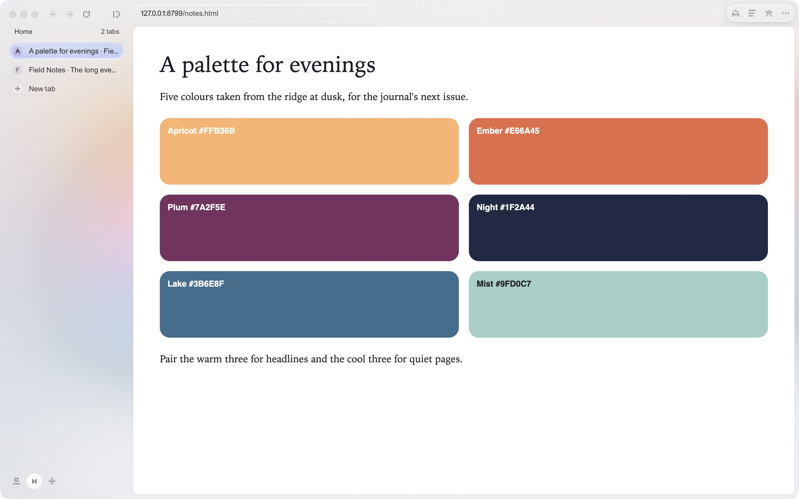
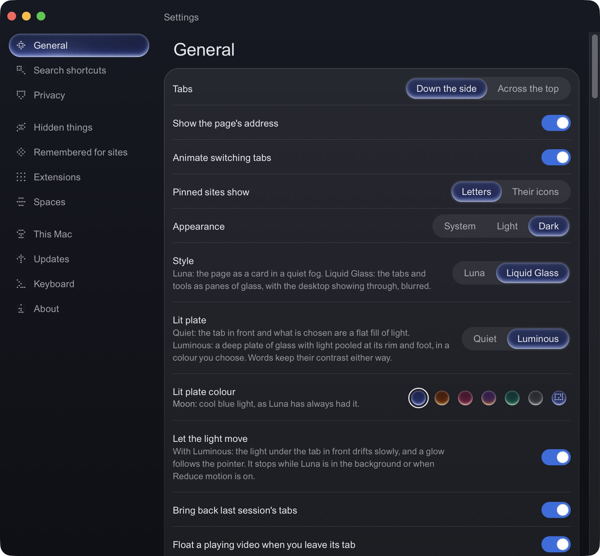
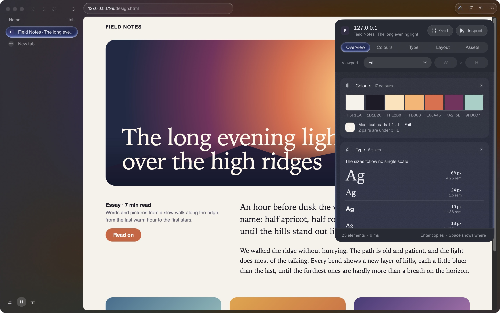

# Luna for macOS

**A small, quiet browser for the Mac.** Tabs down the side or across the top, one field that says what it will do,
and the page. It is the same Luna as [Luna for Windows](https://github.com/lavi-design-studio/luna-releases), built
again for the Mac: the window is drawn natively with **AppKit**, and pages run on **Chromium** (through CEF), so sites
behave as they do in Chrome. At rest Luna's own window uses no CPU, and background tabs sleep to keep memory low.

This repository holds **releases only**: the latest build is on the
[Releases page](https://github.com/lavi-design-studio/luna-mac-releases/releases/latest). The current version is
**0.17.11**. The source is private.

> Every screenshot on this page is a real capture of Luna 0.17.11 on a Mac (Retina). The pages shown are demo pages
> written for these pictures and Luna's own screens; no third-party sites and no personal data.

## Install

1. Download **`Luna-0.17.11.dmg`** (about 170 MB) from the
   [latest release](https://github.com/lavi-design-studio/luna-mac-releases/releases/latest), open it and drag
   **Luna** to **Applications**. The app is about 350 MB once installed, because Chromium comes with it.
2. Luna is signed **ad hoc**, not with an Apple Developer ID, so the first time macOS will not open it with a
   double-click. **Right-click Luna ▸ Open**, then Open again (or System Settings ▸ Privacy & Security ▸
   **Open Anyway**). You only do this once.
3. From then on **Luna updates itself** through Sparkle. Updates are signed with Luna's own key (EdDSA) and checked
   before they are installed; Settings ▸ Updates lets you check by hand or turn it off. After an update macOS may
   ask again for camera, microphone, location and Downloads access, because an ad-hoc signature changes with each
   build.

**Requirements:** a Mac with **Apple silicon** (M1 or later) and **macOS 12 Monterey or later**. Luna is developed
and tested on the latest macOS.

## What it looks like

### Two styles, light and dark, with the light of the page

Luna comes in two styles: **Luna** (the page as a card in a quiet fog) and **Liquid Glass** (the tabs and tools as
panes of glass, with the desktop showing through, blurred), each in light or dark, or following the Mac. The frame
takes its light from the page in front of it, live as you scroll.

The tab you are on, the choice you made and the one action that matters sit on a **lit plate**. In **Settings ▸
General ▸ Lit plate** you choose **Quiet** (a flat fill of light) or **Luminous** (a deep plate of glass with light
pooled at its rim and foot), in seven colours: Moon, Ember, Rose, Dusk, Aurora, Graphite, or one that follows the
page. With *Let the light move*, the light under the tab in front drifts slowly while Luna is in front, and stops in
the background or with Reduce motion on.

### Tabs down the side or across the top, and spaces

Tabs sit **down the side** (`⌘S` folds the sidebar away, the left edge brings it back) or **across the top**
(`⇧⌘S` switches). Pins stay in a row; **spaces** keep separate sets of tabs, each staying signed in or starting
afresh. Last session's tabs come back asleep and wake when you click one; tabs you leave alone go to sleep and stop
drawing. **Private tabs** (`⇧⌘N`) keep nothing.

### One field that says what it will do

`⌘L` raises one field. It finishes addresses from your history, switches to a tab that is already open, searches
otherwise, and works out sums. Search shortcuts like `yt` or `w` search a site straight away (the list is yours, in
Settings). Type **`>`** for every command Luna has, by name, with its key. The row Return will take is lit and says
what it will do. Nothing you type is sent anywhere before you press Return.

### Split view

`⌘\` puts the tab you are on beside the one you were on before; `⌘Return` in the field opens a page beside this
one, and Shift-click on a link peeks it beside the page. Drag the divide to share the space.

### Bookmarks in folders, History, Downloads

`⇧⌘B` bookmarks the page, `⇧⌘O` opens the **Bookmarks** page: folders, a grid with pictures of the pages or a list,
search and sorting. `⌘Y` opens **History** as a timeline, `⌥⌘L` **Downloads**. Reading mode (`⇧⌘R`) lays out the
article and nothing else; `⇧⌘P` floats a playing video.

## Design tools, and Figma

- **Design system** (`⇧⌘D`) lists the page's colours (with contrast), type, layout and assets; values copy as HEX,
  RGB or HSL, and Space shows where each one is used.
- **Grid** (`⇧⌘G`) draws the page's own CSS grid over it. **Inspect** (`⇧⌘E`) shows any element's box, size,
  distances and CSS.
- **Viewport sizes** show the page at a phone, tablet or desktop width.
- **Design snapshot** (`⇧⌘F`) saves the page as layers for Figma; **Copy for Figma** (`⌥⇧⌘F`) puts it on the
  clipboard to paste on a Figma canvas. The **Luna import plugin for Figma** is included: Settings ▸ General ▸
  *Show the plugin folder*, then in the Figma desktop app Plugins ▸ Development ▸ Import plugin from manifest. With
  the plugin, pictures, icons and CSS grids come across too.

## Extensions, import, privacy

- **Chrome extensions (Manifest V3)** install straight from the Chrome Web Store; Settings ▸ Extensions manages
  them.
- **Import** bookmarks and history from **Chrome, Edge, Brave, Vivaldi and Firefox** (Settings ▸ This Mac, or
  `> import` in the field). Each row says how much is new, running it again adds nothing, and Undo removes exactly
  what was added. **Passwords, cookies, cards and open tabs are never read**, and nothing leaves the Mac.
- **Privacy:** ad and tracker blocking in the network layer, **hide anything** on a site for good (`⇧⌘H`), site
  permissions remembered per site (Settings ▸ Remembered for sites), web notifications only for sites you allow
  (never in private tabs), and Luna's own error and certificate pages.

## Not here yet

- **Copy-protected video** (Widevine: Netflix, Disney+, Spotify and similar) does not play: there is no DRM module
  in the app.
- **Saved passwords and autofill:** Luna does not save passwords; use a password manager app.
- **Manifest V2 extensions** are not supported (Manifest V3 only). Adding an extension needs a relaunch, and
  extensions do not run in private tabs.
- No Developer ID signature or notarisation yet (see Install), and no Homebrew cask yet.

## Keyboard

The full list, read from the menu bar so it is always the keys that work, is in **Settings ▸ Keyboard**.

| Keys | Does |
|---|---|
| `⌘L` | Address, or type `>` for commands |
| `⌘K` | Switch to a tab |
| `⌘T` / `⌘W` / `⇧⌘T` | New tab / close tab / reopen closed tab |
| `⇧⌘N` | New private tab |
| `⌘D` | Duplicate tab |
| `⌘1` … `9` | Go to a tab (9: the last) |
| `⇧⌘]` / `⇧⌘[` (also `⌃⇥` / `⌃⇧⇥`, `⌥⌘→` / `⌥⌘←`) | Next tab / previous tab |
| `⌃1` … `9` | Go to a space |
| `⌘R` | Reload |
| `⌘[` / `⌘]` | Back / forward (also a two-finger swipe, and mouse buttons 4 and 5) |
| `⇧⌘V` / `⇧⌘C` | Go to the address you copied / copy address |
| `⌘F` | Find in page |
| `⌘\` | Split view |
| `⌘S` / `⇧⌘S` | Hide or show the sidebar / tabs down the side or across the top |
| `⇧⌘B` / `⇧⌘O` | Bookmark this page / all bookmarks |
| `⌘Y` / `⌥⌘L` | History / downloads |
| `⇧⌘H` / `⇧⌘U` | Hide something on this site / what is hidden here |
| `⇧⌘R` | Reading mode |
| `⇧⌘P` | Float the video |
| `⇧⌘G` / `⇧⌘D` / `⇧⌘E` | Page grid / design system / inspect |
| `⇧⌘F` / `⌥⇧⌘F` | Save design snapshot / copy for Figma |
| `⌥⌘I` | Developer tools |
| `⌘Z` | Undo what a toast offers |
| `⌘,` | Settings |
| `⌘.` | You: settings, the lists and the other look |
| `⌃⌘F` | Full screen |
| `Esc` | Put away whatever is open |

## Luna for Windows

Luna started on Windows, where it runs on WebView2: see
[lavi-design-studio/luna-releases](https://github.com/lavi-design-studio/luna-releases). The Mac version follows
it feature for feature where that makes sense on a Mac (0.17.11 here follows Windows 0.17.10), with the Mac's own
keys, menus, panels and updater. What differs: the Mac bundles its own Chromium (so the app is larger), it has no
protected video, and Luna does not keep passwords.

## Issues and support

Found something wrong, or missing? Open an
[issue](https://github.com/lavi-design-studio/luna-mac-releases/issues) with your Mac model, macOS version and Luna
version (Settings ▸ About). Luna writes runtime errors to `errors.log` in its data folder; attaching it helps.

## Licence

Luna is made by [Lavi Design Studio](https://github.com/lavi-design-studio). The builds are free to use; a licence
has not been specified yet. Pages run on Chromium through the Chromium Embedded Framework (BSD licence); updates
use [Sparkle](https://sparkle-project.org).
