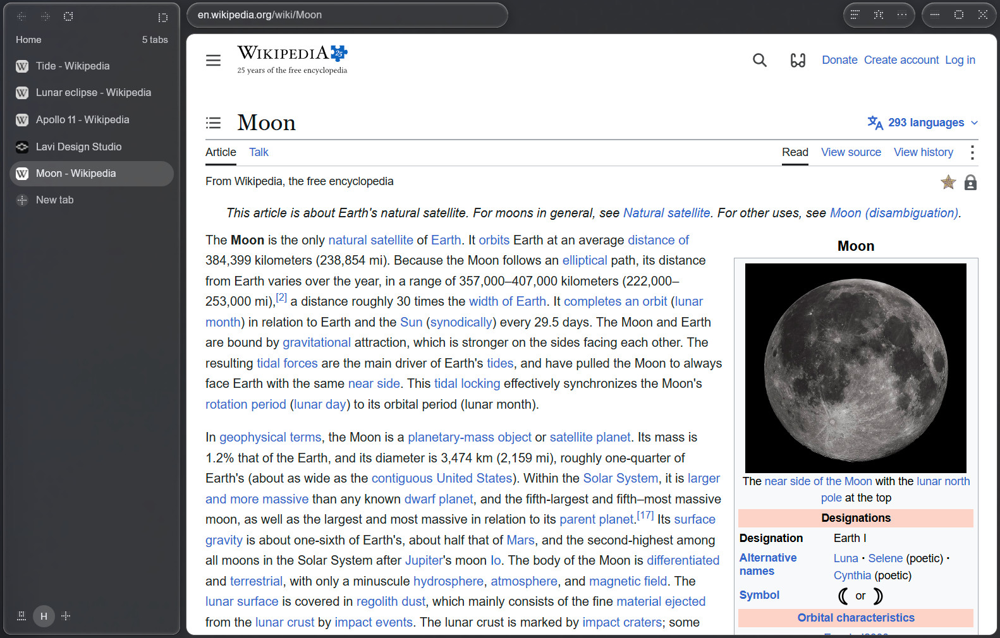

# Luna for macOS

**A small, quiet browser for the Mac.** The same Luna as [Luna for Windows](https://github.com/lavi-design-studio/luna-releases): tabs down the side or across the top, one field that says what it will do, and the page. On the Mac it draws its own window with AppKit and runs pages on **Chromium** (CEF), so sites behave as they do in Chrome. It uses no CPU while you are not using it, and background tabs sleep to keep memory low.

This repository holds **releases only**: the latest build is on the [Releases page](https://github.com/lavi-design-studio/luna-mac-releases/releases/latest). The source is private.

## Install
1. Download **Luna-<version>.dmg** from the latest release and drag Luna to Applications.
2. Luna is signed ad hoc, not with an Apple Developer ID. The first time: right-click Luna ▸ **Open** (or System Settings ▸ Privacy & Security ▸ **Open Anyway**).
3. From then on Luna updates itself (Sparkle). After an update macOS may ask again for camera, microphone, location and Downloads access.

Requires an Apple silicon Mac (macOS 14 or later).

## What is in it
- Tabs down the side or across the top, spaces, pinned sites, split view (⌘\\), the **field** (type to search, `>` for commands), the Shelf.
- Two styles, **Luna** and **Liquid Glass**, light or dark; Quiet or **Luminous** plates in seven colours, living light.
- Bookmarks in folders with pictures, a History timeline, Downloads, site permissions, floating video, import from Chrome, Edge, Brave, Vivaldi and Firefox.
- **Design tools:** Design system panel, page grid, Inspect with distances, viewport sizes, design snapshot and Copy for Figma (the Figma import plugin is included: Settings ▸ General ▸ Show the plugin folder).
- **Chrome extensions** (Manifest V3) from the Chrome Web Store.

## Not here (yet)
Copy-protected video (Widevine: Netflix, Disney+, Spotify), saved passwords and autofill, Manifest V2 extensions.

## Updates, Homebrew
Luna checks for updates by itself (Settings ▸ Updates). The release also carries a Homebrew cask.

Luna is made by [Lavi Design Studio](https://github.com/lavi-design-studio). Licence: not yet specified; the builds are free to use.
